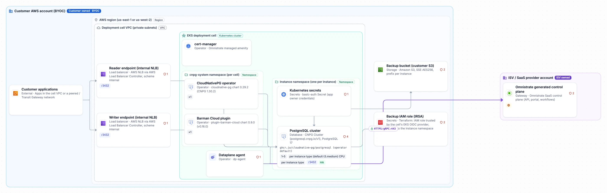
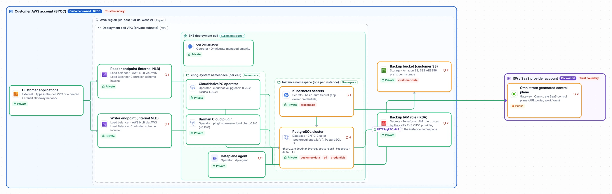
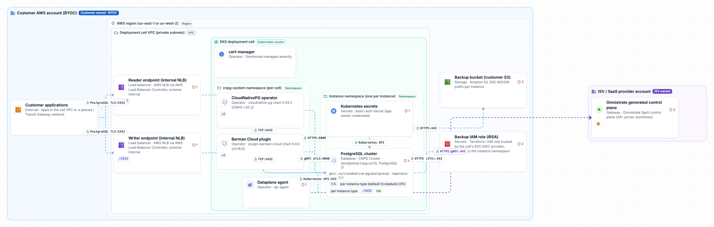
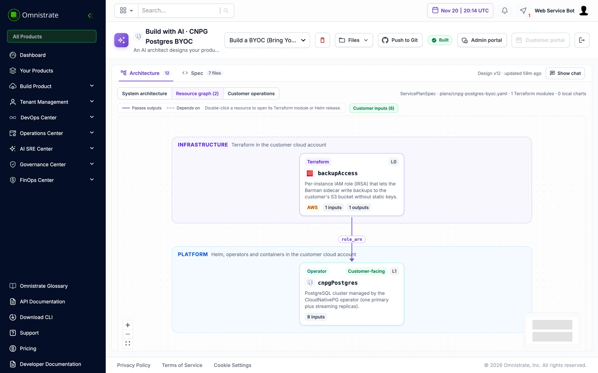
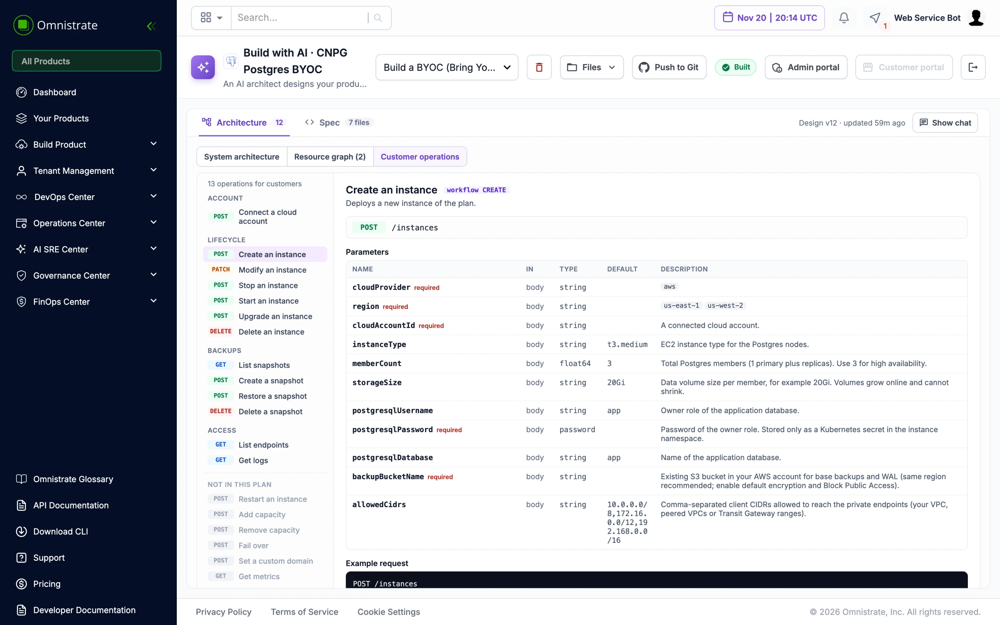
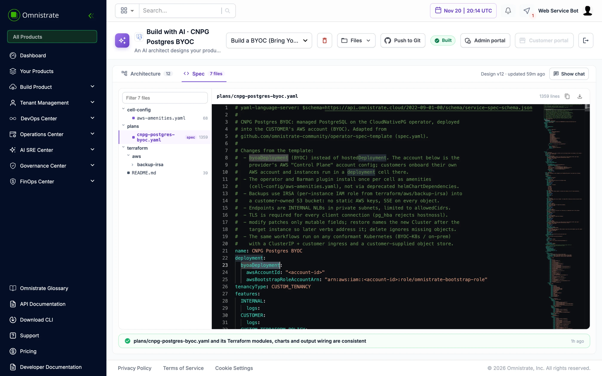
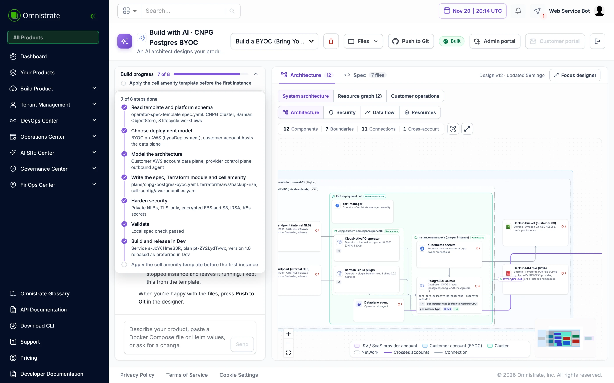
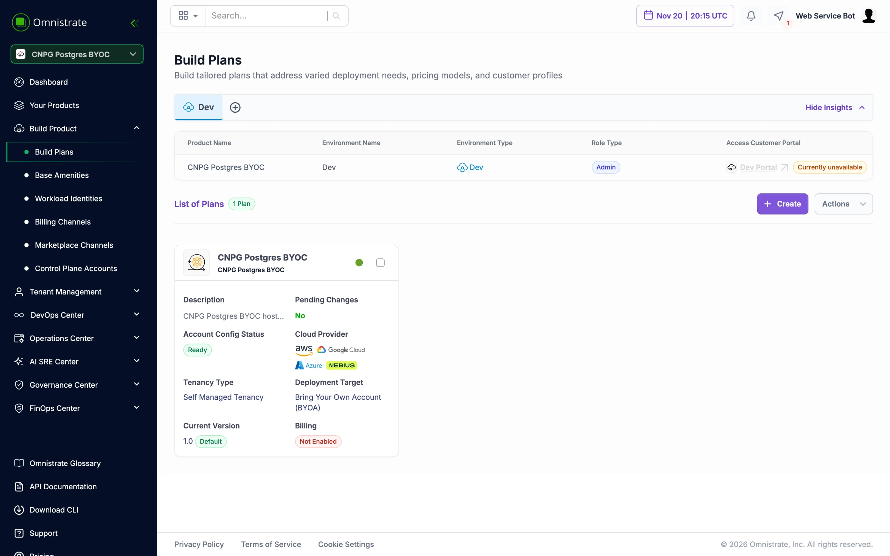

# CNPG Postgres BYOC

This folder holds a Bring Your Own Cloud (BYOC) variant of the CloudNativePG service plan in this repository. The data plane runs in the customer's own AWS account: the EKS deployment cell, the CloudNativePG operator, the Postgres pods and the backups. The control plane that Omnistrate generates runs in the provider's account, and the dataplane agent in the customer's account connects outbound to it.

The Omnistrate AI architect produced this plan from the top-level `spec.yaml` in this repository. It designed the architecture, wrote the spec and the supporting Terraform module, validated it and built and released it in a Dev environment, in about 14 minutes. No instance was deployed.

## Files

| Path | Contents |
|---|---|
| `plans/cnpg-postgres-byoc.yaml` | The ServicePlanSpec for the plan "CNPG Postgres BYOC". |
| `terraform/aws/backup-irsa/` | A Terraform module that creates a per-instance IAM role (IRSA) for Barman Cloud backups. |
| `cell-config/aws-amenities.yaml` | The deployment cell amenities: the CloudNativePG operator, the Barman Cloud plugin and an encrypted gp3 StorageClass. |

## Changes from the hosted template

- The plan uses `byoaDeployment`, so every instance runs in a deployment cell in the customer's AWS account.
- The operator and the Barman Cloud plugin install once per cell as amenities instead of as Helm chart dependencies.
- Backups use a per-instance IAM role (IRSA) to write to a customer-owned S3 bucket, so the plan holds no static AWS keys.
- The writer and reader endpoints are internal NLBs in private subnets, limited to the `allowedCidrs` parameter.
- Postgres rejects client connections that do not use TLS.
- The workflows only change CloudNativePG custom resources, so the same plan also works on customer-managed Kubernetes.

## Architecture

The architecture view shows the customer AWS account as the boundary that holds the region, the deployment cell VPC, the EKS cluster and the per-instance namespace. The only connection that crosses into the provider account is the outbound HTTPS/gRPC connection from the dataplane agent to the generated control plane.



The security lens marks the trust boundaries, which endpoints are private, how traffic is encrypted and which components hold customer data or credentials.



The data flow lens shows how client traffic reaches Postgres through the internal NLBs and how backups flow to the customer's S3 bucket.



## Resources

The resource graph shows the Omnistrate resources in the plan, the Terraform module and the Helm releases, and how outputs pass between them.



## Customer operations

Omnistrate turns each system workflow in the spec into an API, a Customer Portal action and a CLI command. The customer operations view lists every operation with its parameters, in the same form as API documentation.



| Operation | What it does |
|---|---|
| Create | It creates the basic-auth Secret and the ObjectStore, then the CNPG Cluster, and it finishes when every member is ready. |
| Modify | It patches the member count, the storage size, the instance type and the allowed CIDRs. |
| Stop and start | They turn CloudNativePG hibernation on and off. |
| Backup | It creates a Barman Cloud Backup. Backups also run every 24 hours and before deletion. |
| Restore | It creates a new instance that bootstraps from the snapshot's backup. |
| Delete backup | It removes the Backup resource, and the S3 data ages out under the 7-day retention policy. |
| Delete | It removes the Cluster, the Secret and the ObjectStores. |

## Spec



## Build

The build progress panel lists each step the AI architect completed. The plan was built and released as version 1.0 in Dev.



The released plan appears in Build Plans with the BYOA deployment target.



## Build it yourself

Set `awsAccountId` and `awsBootstrapRoleAccountArn` in the spec to your control plane AWS account, then run:

```bash
omnistrate-ctl build -f plans/cnpg-postgres-byoc.yaml --spec-type ServicePlanSpec \
  --product-name "CNPG Postgres BYOC" --environment Dev --environment-type dev --release-as-preferred
```

Before the first instance, apply `cell-config/aws-amenities.yaml` to the AWS deployment cell configuration template so that every new cell gets the operator, the plugin and the StorageClass. Each customer then connects their AWS account and creates an S3 bucket with default encryption and Block Public Access for backups.
