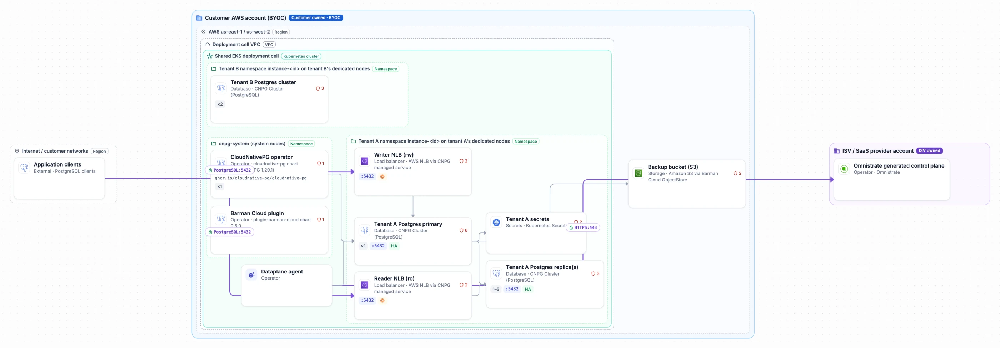
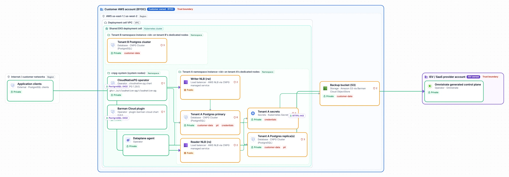
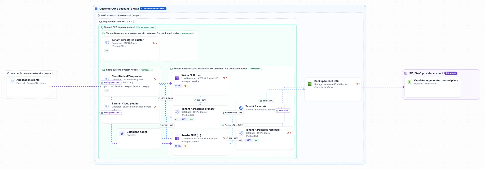
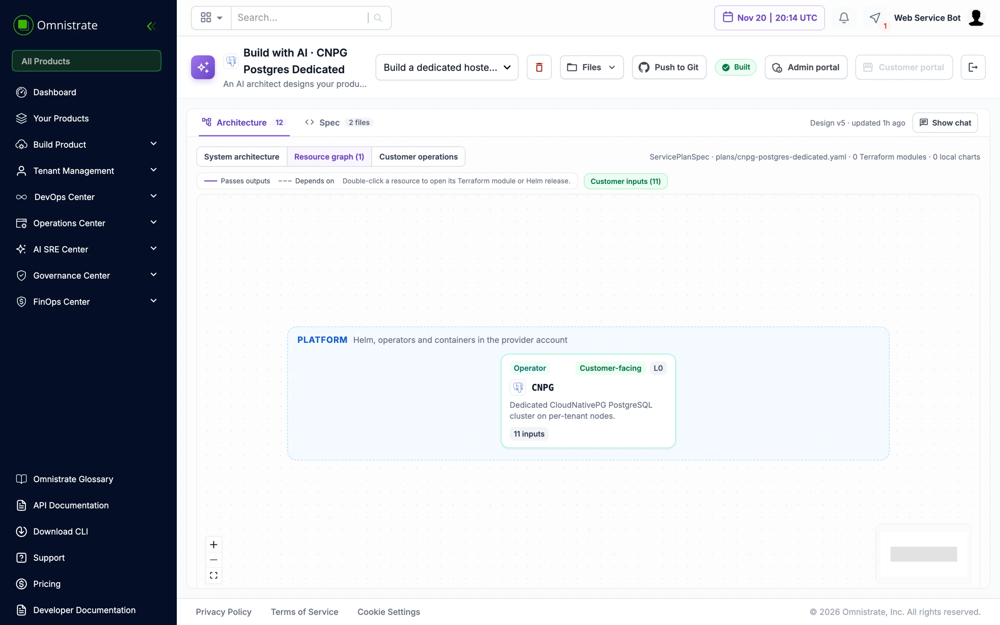
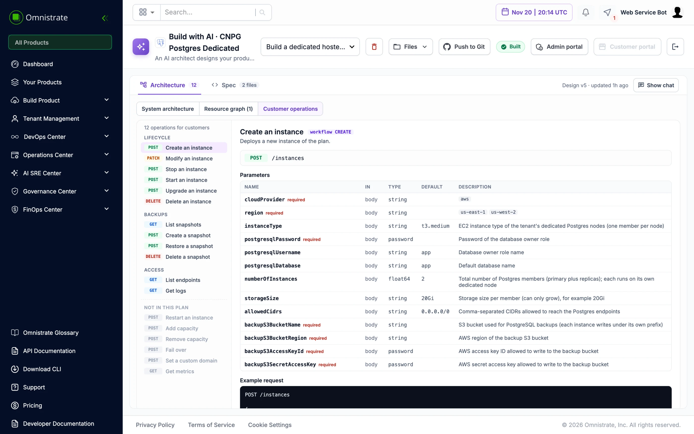
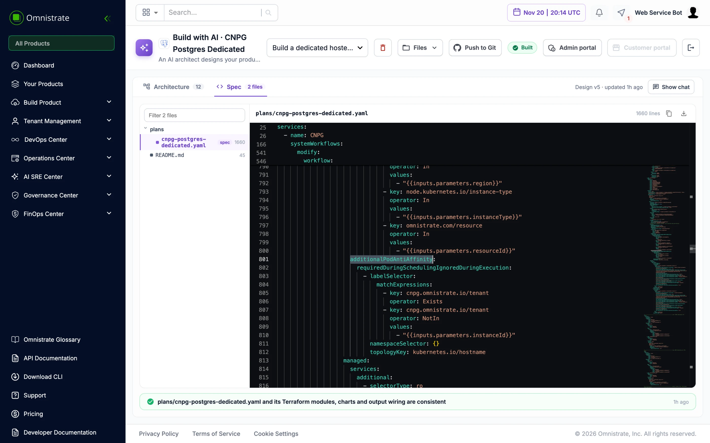
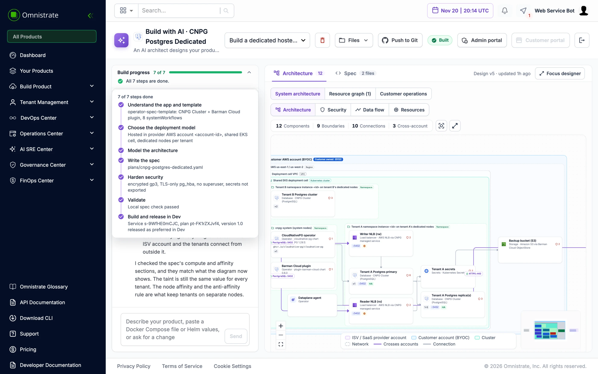
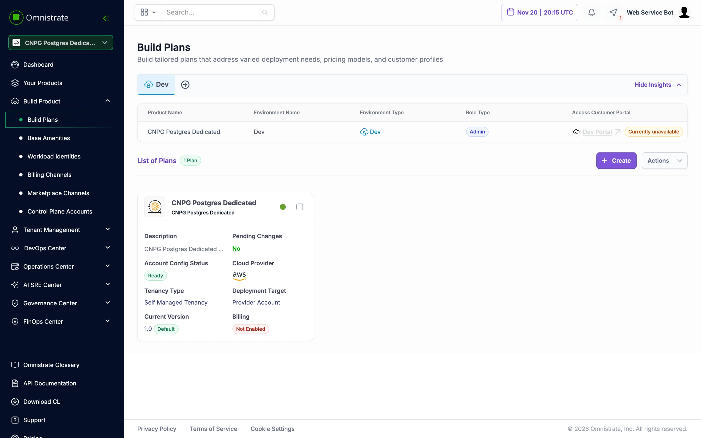

# CNPG Postgres Dedicated

This folder holds a dedicated hosted variant of the CloudNativePG service plan in this repository. The service runs in the provider's AWS account on a shared deployment cell per region, and affinity rules give each tenant its own nodes, so two tenants never share a node.

The Omnistrate AI architect produced this plan from the top-level `spec.yaml` in this repository. It designed the architecture, wrote the spec, validated it and built and released it in a Dev environment, in about 13 minutes. No instance was deployed.

## Files

| Path | Contents |
|---|---|
| `plans/cnpg-postgres-dedicated.yaml` | The ServicePlanSpec for the plan "CNPG Postgres Dedicated". |

## Tenant node isolation

Each tenant instance gets its own Omnistrate node group, and the CNPG Cluster's `spec.affinity` pins the tenant's Postgres pods to it:

| Layer | Where | Rule |
|---|---|---|
| Node group | `compute.instanceTypes[].configurationOverrides` | The nodes carry the label `cnpg.omnistrate.io/pool=dedicated-postgres` and the taint `cnpg.omnistrate.io/dedicated=postgres:NoSchedule`. |
| Node affinity | `affinity.nodeAffinity` (required) | Pods only schedule on nodes with the tenant's `omnistrate.com/resource` ID, region and instance type. |
| Node selector | `affinity.nodeSelector` | Pods only schedule on the dedicated pool. |
| Toleration | `affinity.tolerations` | Pods tolerate only the dedicated taint. |
| Replica spread | `affinity.podAntiAffinityType: required` | Each Postgres member runs on a different node. |
| Cross-tenant | `affinity.additionalPodAntiAffinity` (required, all namespaces) | Pods never schedule on a node that runs another tenant's pod. |

The taint keeps every other workload off the dedicated pools. The per-tenant node affinity and the cross-tenant anti-affinity together keep two tenants off the same node.

## Architecture

The architecture view groups each tenant's namespace on that tenant's dedicated nodes inside the shared EKS deployment cell.



The security lens marks the trust boundaries, which endpoints are private, how traffic is encrypted and which components hold customer data or credentials.





## Resources



## Customer operations

Omnistrate turns each system workflow in the spec into an API, a Customer Portal action and a CLI command. The customer operations view lists every operation with its parameters.



| Operation | What it does |
|---|---|
| Create | It creates the encrypted StorageClass, the auth and S3 Secrets, the Barman ObjectStore and the CNPG Cluster, and it waits until every member is ready. |
| Modify | It re-applies the Secrets, the ObjectStore and the Cluster to change `numberOfInstances` (1 to 5), grow `storageSize`, change `instanceType`, rotate backup keys or change `allowedCidrs`. |
| Stop and start | They turn CloudNativePG hibernation on and off, and the volumes are kept. |
| Backup | It wakes a hibernated cluster and then creates a Barman Backup named after the snapshot. Backups also run every 24 hours and before deletion, and they are kept for 7 days. |
| Restore | It creates a new cluster from the snapshot with the same isolation rules. |
| Delete backup | It deletes the Backup resource for the snapshot. |
| Delete | It deletes the Cluster, then the ObjectStore and the Secrets. |

## Spec

The spec view below shows the cross-tenant pod anti-affinity rule in the modify workflow.



## Build





## Build it yourself

Set `awsAccountId` and `awsBootstrapRoleAccountArn` in the spec to your AWS account, then run:

```bash
omnistrate-ctl build -f plans/cnpg-postgres-dedicated.yaml --spec-type ServicePlanSpec \
  --product-name "CNPG Postgres Dedicated" --environment Dev --environment-type dev --release-as-preferred
```

On the first instance, check that the node labels and taints were applied with `kubectl get nodes --show-labels`.
