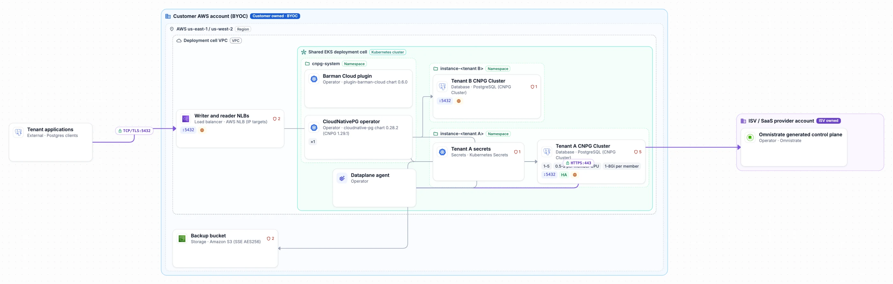
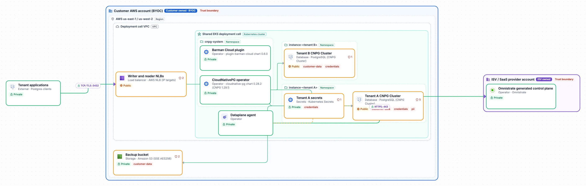
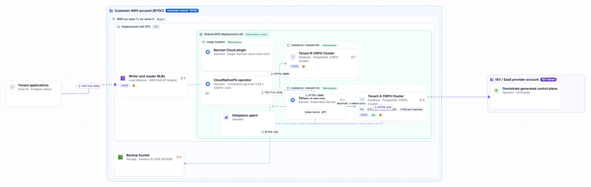
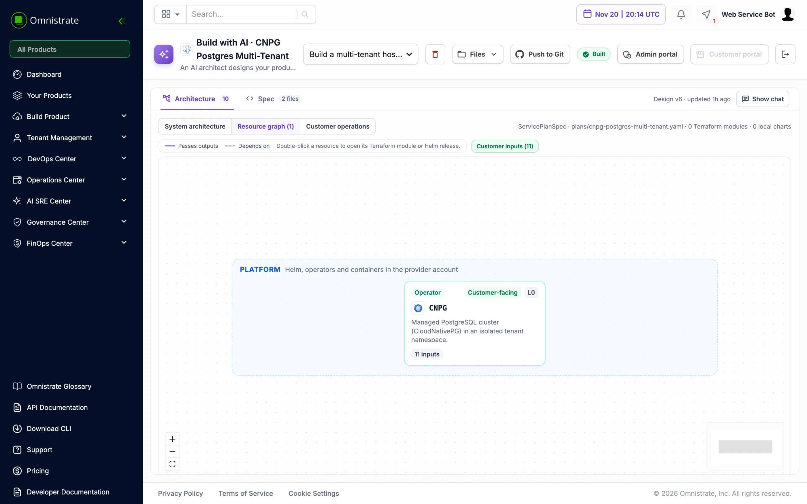
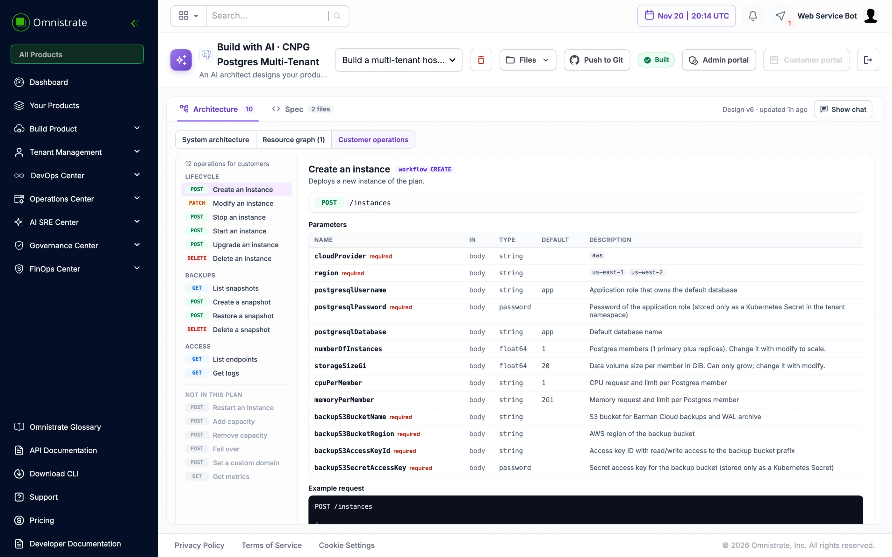
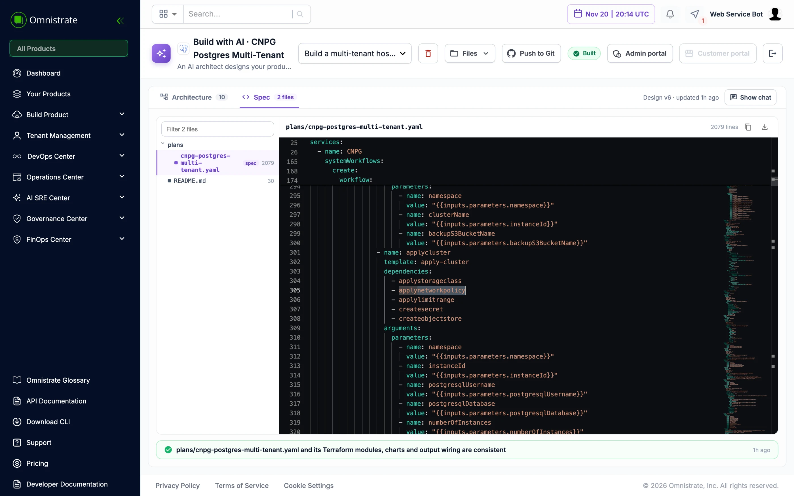
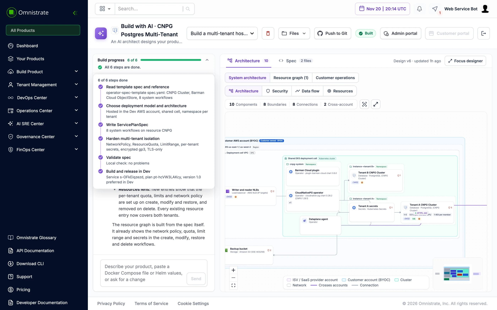
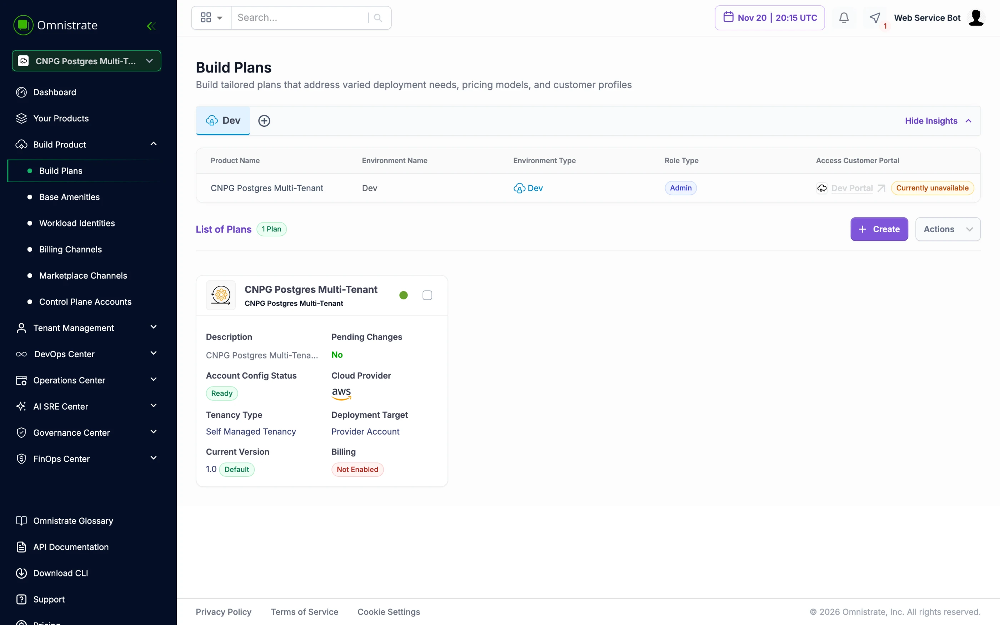

# CNPG Postgres Multi-Tenant

This folder holds a multi-tenant hosted variant of the CloudNativePG service plan in this repository. The service runs in the provider's AWS account. Tenants share one deployment cell per region, and each tenant instance gets its own Kubernetes namespace with its own isolation objects.

The Omnistrate AI architect produced this plan from the top-level `spec.yaml` in this repository. It designed the architecture, wrote the spec, validated it and built and released it in a Dev environment, in about 10 minutes. No instance was deployed.

## Files

| Path | Contents |
|---|---|
| `plans/cnpg-postgres-multi-tenant.yaml` | The ServicePlanSpec for the plan "CNPG Postgres Multi-Tenant". |

## Tenant isolation

Every create, modify and restore applies these objects in the tenant's namespace:

- A NetworkPolicy named `tenant-isolation` denies traffic from other namespaces by default.
- A ResourceQuota named `tenant-quota` and a LimitRange named `tenant-limits` cap what one tenant can consume.
- The tenant's Secrets hold its application role and its backup credentials.

Volumes use the encrypted gp3 StorageClass `cnpg-gp3-encrypted`, backups to S3 use server-side encryption, and Postgres rejects client connections that do not use TLS.

## Architecture



The security lens marks the trust boundaries, which endpoints are private, how traffic is encrypted and which components hold customer data or credentials.





## Resources



## Customer operations

Omnistrate turns each system workflow in the spec into an API, a Customer Portal action and a CLI command. The customer operations view lists every operation with its parameters.



| Operation | What it does |
|---|---|
| Create | It creates the StorageClass, the isolation objects, the Secrets, the Barman ObjectStore and the CNPG Cluster, and it waits for the members to be ready. |
| Modify | It re-applies the isolation objects, the backup configuration and the Cluster to change members, CPU, memory or storage. |
| Stop and start | They turn CloudNativePG hibernation on and off, and the volumes are kept. |
| Backup | It wakes a hibernated cluster and then creates a Backup through the Barman Cloud plugin. |
| Restore | It creates a new instance in its own isolated namespace from the snapshot. |
| Delete backup | It deletes the Backup resource. |
| Delete | It deletes the Cluster, the Secrets, the ObjectStore and the isolation objects. |

## Spec

The spec view below shows the create workflow, which applies the NetworkPolicy before the Cluster.



## Build





## Build it yourself

Set `awsAccountId` and `awsBootstrapRoleAccountArn` in the spec to your AWS account, then run:

```bash
omnistrate-ctl build -f plans/cnpg-postgres-multi-tenant.yaml --spec-type ServicePlanSpec \
  --product-name "CNPG Postgres Multi-Tenant" --environment Dev --environment-type dev --release-as-preferred
```
